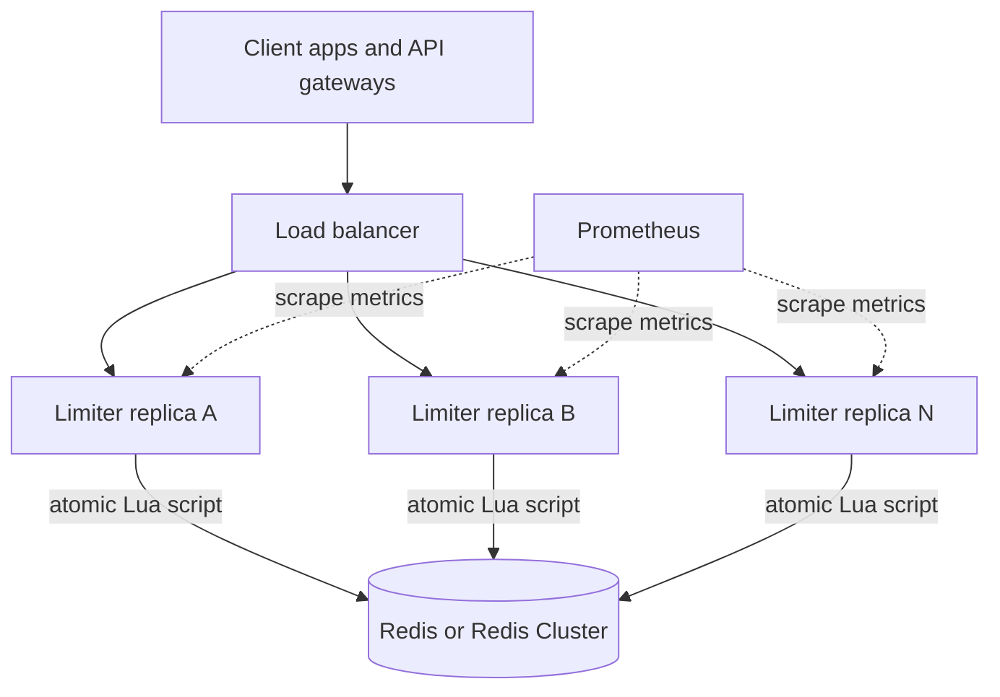
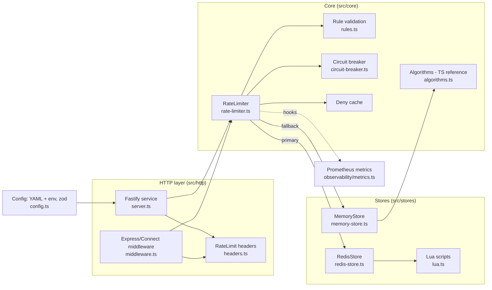
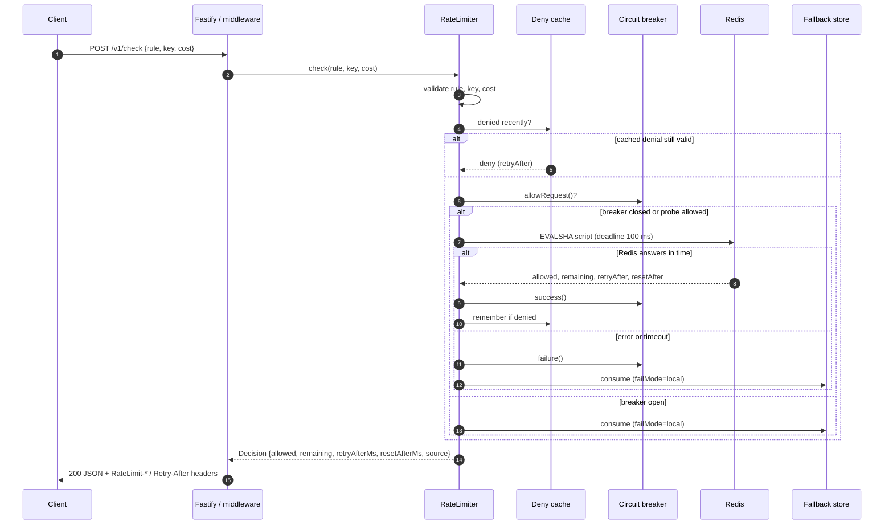
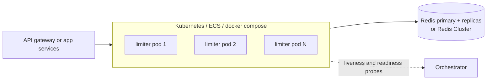
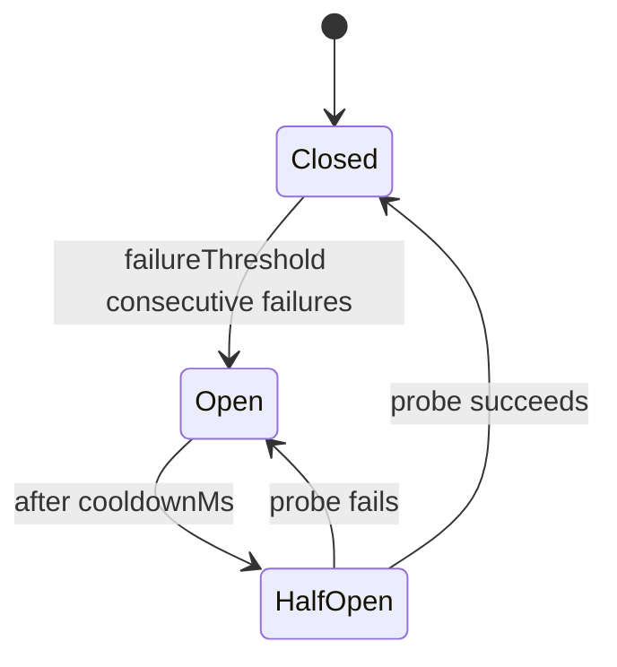

# Distributed Rate Limiter

A production-grade distributed rate limiter for Node.js, backed by Redis.

It enforces **one shared limit across any number of servers**. Every decision is a single atomic Lua script in Redis, timed by the Redis clock. It stays up when Redis is slow or down, using deadlines, a circuit breaker, a per-node fallback and a local denial cache.

You can use it two ways:

- **As a service:** a stateless HTTP decision API (`POST /v1/check`). Run N replicas behind a load balancer and call it from any language.
- **As a library:** `RateLimiter` plus Express/Connect middleware, embedded in your Node services and sharing the same Redis.

**Contents:** [Architecture](#architecture) · [Algorithms](#algorithms) · [Failure handling](#failure-handling) · [Getting started](#getting-started) · [HTTP API](#http-api) · [Library usage](#library-usage) · [Configuration](#configuration) · [Observability](#observability) · [Testing](#testing) · [Design trade-offs](#design-trade-offs)

---

## Architecture

### System overview



- **Replicas are stateless.** All authoritative state lives in Redis, so you scale by adding replicas. Each replica holds only a short-lived denial cache and a fallback store used during outages.
- **Redis is the single source of truth.** Each `(rule, key)` pair maps to one small Redis record. Concurrent checks from any number of replicas are serialised by Redis itself.
- **Embedded mode is the same picture.** Your own Node services take the replicas' place and import the library instead of calling HTTP.

### Components



| Component | Responsibility |
|---|---|
| `RateLimiter` | Orchestrates a check: validates input, consults the deny cache, calls the primary store under a deadline and the circuit breaker, and degrades according to the fail mode. Never throws because of store failures. |
| `RateLimitStore` interface | `consume(rule, key, cost)`, `reset`, `ping`, `close`. Any backend implementing it can be plugged in. |
| `RedisStore` | Runs one Lua script per check through ioredis `defineCommand`, which uses EVALSHA and falls back to EVAL automatically after a failover or `SCRIPT FLUSH`. Works with standalone Redis and Redis Cluster. |
| Lua scripts | The algorithms themselves, executed atomically inside Redis. |
| `MemoryStore` | In-process store with LRU bounds and TTL sweeping. Used for tests, single-node deployments, and as the per-node fallback. |
| Algorithms (TS) | Reference implementations, line-for-line twins of the Lua scripts. |
| `CircuitBreaker` | Closed, open and half-open states. Stops calling a failing Redis and probes for recovery. |
| Fastify service | REST API, bearer-token auth, schema validation, health and readiness probes, metrics endpoint, graceful shutdown. |
| Middleware | Express/Connect-compatible; sets headers and answers `429`. |
| Metrics | Prometheus counters, histograms and gauges fed by limiter hooks. |
| Config | YAML file plus environment overrides, validated with zod. Fails fast with field-level errors. |

### Request lifecycle



`decision.source` records which path answered: `store`, `deny-cache`, `fallback`, `fail-open` or `fail-closed`.

### Why it is correct across nodes

| Concern | How it is handled |
|---|---|
| **Races** | Read, decide and write happen in one Lua script, which Redis executes atomically. Two replicas can never both take the last slot. In a test, 8 independent connections race 600 requests at a limit of 100, and exactly 100 are admitted for every algorithm. |
| **Clock skew** | Scripts read `now` from Redis `TIME`, so drift between app servers cannot change limits. A `client` clock mode exists for tests. |
| **Cluster sharding** | All keys for a `(rule, key)` pair share a hash tag, `{rule:key}`. Multi-key scripts stay on one slot, while different keys spread across shards. |
| **Float drift** | All arithmetic is integer: rates are scaled by `windowMs`. The Lua and TypeScript implementations therefore agree bit for bit, and one contract test suite runs against both. |
| **Unbounded memory** | Every key gets a TTL equal to how long its state matters, so idle keys delete themselves. |
| **Write amplification** | Denials don't write (except log pruning), so a client hammering its limit causes only reads. |

### Redis data model

Keys look like `<prefix>:{<rule>:<key>}:<suffix>`, for example `rl:{api-per-ip:203.0.113.7}:tb`.

| Algorithm | Key suffix | Type | Contents | TTL |
|---|---|---|---|---|
| `token-bucket` | `tb` | HASH | `u` = tokens × windowMs, `ts` = last update (ms) | time until the bucket is full again |
| `sliding-window` | `sw` | HASH | `ws` = current window start, `c` = current count, `p` = previous count | until the end of the next window |
| `fixed-window` | `fw` | HASH | `ws` = window start, `c` = count | until the window ends |
| `sliding-log` | `sl`, `sl:seq` | ZSET + STRING | one member per admitted unit (score = timestamp); sequence counter for unique members | one window |

The algorithm is part of the key, so changing a rule's algorithm never hits a `WRONGTYPE` error on old data.

### Deployment topology



- Run Redis with `maxmemory-policy volatile-ttl` (or `volatile-lru`), never `noeviction`. Under memory pressure, forgetting a limit is better than failing writes.
- Persistence is optional; losing limiter state only resets counters.
- The container runs `node` directly, so `SIGTERM` triggers a graceful drain.

---

## Algorithms

| Algorithm | Memory per key | Accuracy | Best for |
|---|---|---|---|
| `token-bucket` | O(1) | exact | General API limits. Smooth refill of `limit` per `window`, with bursts up to `burst`. |
| `sliding-window` | O(1) | ~exact (weighted estimate) | Large rolling quotas such as 5000/hour. |
| `sliding-log` | O(limit) | exact | Small, strict limits: login attempts, OTP sends. |
| `fixed-window` | O(1) | up to 2× at window edges | Cheap quotas aligned to the clock, such as a daily cap. |

How each one decides:

- **Token bucket:** `tokens = min(burst, tokens + elapsed × limit / window)`. Admit if `tokens ≥ cost`.
- **Sliding window:** `estimate = prev × (window − elapsed) / window + current`. Admit if `estimate + cost ≤ limit`.
- **Sliding log:** drop entries older than one window. Admit if `count + cost ≤ limit`.
- **Fixed window:** counter for the aligned window `[now − now mod window, …)`. Admit if `count + cost ≤ limit`.

Every decision returns `remaining`, `retryAfterMs` and `resetAfterMs` (time until the quota is fully restored). `retryAfterMs` is exact: a request is denied 1 ms before it and admitted at it, which tests verify for every algorithm. A request with `cost: 0` inspects the state without consuming anything.

---

## Failure handling



| Mechanism | Behaviour |
|---|---|
| **Deadline** (`timeoutMs`, default 100 ms) | Every store call is bounded; a slow Redis counts as a failure. |
| **Circuit breaker** | After `failureThreshold` failures (default 5), Redis is skipped for `cooldownMs` (default 5 s). Then exactly one probe is sent. |
| **Fail mode** | `local` (default): per-node in-memory limits, so the ceiling degrades to about `nodes × limit` instead of disappearing. `open`: admit everything. `closed`: reject everything, for limits that guard hard upstream quotas. |
| **Fail-fast client** | No ioredis offline queue, at most 1 retry, capped reconnect backoff, auto-pipelining. |
| **Deny cache** | Each node remembers a denial until its `retryAfter` and rejects repeats without a Redis round-trip. This is safe because a denial stays true until then. Only requests at least as expensive as the denied one are short-circuited. |

---

## Getting started

Requires Node.js 20+ and Docker (for Redis).

```bash
npm install
npm run redis:up          # Redis 7 in Docker on :6379
npm test                  # unit + live-Redis integration tests
npm run dev               # service on :8080, using config/rate-limiter.yaml
```

Two replicas sharing one Redis:

```bash
docker compose up --build   # limiter-a on :8081, limiter-b on :8082
```

Try it:

```bash
curl -s localhost:8080/v1/check -H 'content-type: application/json' \
  -d '{"rule":"login-attempts","key":"alice"}'
```

Production build:

```bash
npm run build && npm start
```

---

## HTTP API

```http
POST /v1/check
{"rule": "api-per-ip", "key": "203.0.113.7", "cost": 1}

200 OK
RateLimit-Limit: 100
RateLimit-Remaining: 119
RateLimit-Reset: 1
RateLimit-Policy: 100;w=60
{"allowed":true,"rule":"api-per-ip","limit":100,"remaining":119,"retryAfterMs":0,"resetAfterMs":600,"source":"store"}
```

A denial is still `200`, with `"allowed": false` and a `Retry-After` header. The caller decides how to surface it.

| Endpoint | Purpose |
|---|---|
| `POST /v1/check` | Check one rule. `cost` defaults to 1; `0` only inspects. |
| `POST /v1/check/batch` | `{"checks":[...]}`, up to 16 checks. Allowed only if every rule allows. `binding` names the rule to report. |
| `POST /v1/reset` | `{"rule","key"}` clears a key (operator unblock). |
| `GET /v1/rules` | Lists the configured rules. |
| `GET /healthz` | Liveness. |
| `GET /readyz` | `503` when Redis is unreachable. In `local`/`open` mode the service still answers, so alert on this rather than removing every replica at once. |
| `GET /metrics` | Prometheus. |

**Errors:** `400` for invalid input (including unknown fields and a cost above the rule's capacity), `401` for a bad token, `404` for an unknown rule.

**Auth:** when `API_TOKEN` is set, `/v1/*` requires `Authorization: Bearer <token>`. The token is compared in constant time.

---

## Library usage

```ts
import { Redis } from 'ioredis';
import express from 'express';
import { RateLimiter, RedisStore, rateLimit } from 'distributed-rate-limiter';

const limiter = new RateLimiter({
  store: new RedisStore(new Redis(process.env.REDIS_URL!, { enableAutoPipelining: true, enableOfflineQueue: false })),
  rules: [
    { name: 'api', algorithm: 'token-bucket', limit: 100, windowMs: 60_000, burst: 120 },
    { name: 'login', algorithm: 'sliding-log', limit: 5, windowMs: 15 * 60_000 },
  ],
  failMode: 'local',
});

const app = express();
app.set('trust proxy', 1); // so req.ip is the client, not the load balancer
app.use(rateLimit(limiter, { rule: 'api' }));
app.post('/login', rateLimit(limiter, { rule: 'login', key: (req) => req.body?.username }), handler);

// Or call it directly, with several rules at once:
const { allowed, binding } = await limiter.checkMany([
  { rule: 'api', key: ip },
  { rule: 'login', key: username },
]);
```

`check()` throws only for caller mistakes (`UnknownRuleError`, `InvalidRequestError`). Store failures are handled by the fail mode, never thrown.

---

## Configuration

Settings live in `config/rate-limiter.yaml` (path from `CONFIG_FILE`). They're validated at startup, errors name the field, and unknown keys are rejected.

```yaml
limiter:
  failMode: local        # local | open | closed
  timeoutMs: 100
  circuitBreaker: { failureThreshold: 5, cooldownMs: 5s }

rules:
  - name: api-per-ip
    algorithm: token-bucket
    limit: 100
    window: 1m           # 500ms, 30s, 15m, 1h, 1d
    burst: 120
```

Environment variables override the file. Keep secrets here, not in YAML.

| Variable | Overrides |
|---|---|
| `PORT`, `HOST`, `LOG_LEVEL` | `server.*` |
| `API_TOKEN` | `server.apiToken` (at least 16 characters) |
| `REDIS_URL` | `redis.url` |
| `REDIS_CLUSTER_NODES` | `redis.clusterNodes`: comma-separated `host:port` seeds, enables Cluster mode |
| `REDIS_KEY_PREFIX` | `redis.keyPrefix` |
| `FAIL_MODE` | `limiter.failMode` |
| `STORE_TIMEOUT_MS` | `limiter.timeoutMs` |

---

## Observability

| Metric | Meaning |
|---|---|
| `ratelimit_decisions_total{rule,outcome,source}` | Decisions by result and path. Alert when `source=~"fallback\|fail-.*"` is non-zero. |
| `ratelimit_decision_duration_seconds{source}` | Decision latency, including the Redis round-trip. |
| `ratelimit_store_errors_total{rule,error}` | Redis errors and timeouts. |
| `ratelimit_circuit_state` | 0 closed, 1 half-open, 2 open. |

Node.js process metrics are included. The limited key is never a label, so cardinality stays bounded. Logs are structured JSON (pino), and per-request access logs are off on the hot path.

---

## Testing

```bash
npm test          # everything; Redis tests are skipped automatically if Redis is unreachable
npm run test:unit # no Redis needed
```

| Suite | Covers |
|---|---|
| `store-contract.ts` | Shared behaviour contract, run against both MemoryStore and live Redis. This proves the Lua and TypeScript implementations agree. |
| `redis-store.redis.test.ts` | Multi-node race (exactly `limit` admitted), server clock, hash-tag and TTL layout, recovery after `SCRIPT FLUSH`. |
| `rate-limiter.test.ts` | Fail modes, deadlines, circuit breaker transitions, deny cache, `checkMany`, validation. |
| `server.test.ts` | HTTP API, headers, validation, auth, probes, metrics. |
| `middleware.test.ts` | Express-style middleware over a real HTTP server. |
| `config.test.ts` | Durations, defaults, env overrides, error reporting. |

---

## Design trade-offs

- **`checkMany` is not transactional.** Rules may live on different cluster shards. If rule A admits and rule B denies, A's unit is still consumed. This errs toward protection, and the checks run in parallel, so a batch costs one round-trip of latency.
- **Timeouts are not cancellations.** A check that times out may still be applied by Redis afterwards. This is negligible in practice.
- **The deny cache is per node.** After `POST /v1/reset`, other nodes may keep rejecting that key until its cached retry time. Set `denyCache: false` if instant unblocks matter more than shedding abusive load.
- **`local` fail mode is approximate.** During an outage each node enforces the full limit, so the cluster-wide ceiling is `nodes × limit`. Supply a custom `fallbackStore` for tighter bounds.

---

## Project structure

```
src/
├── core/
│   ├── rate-limiter.ts      # orchestration: validation, deny cache, breaker, deadline, fail modes
│   ├── algorithms.ts        # TypeScript reference algorithms (twins of the Lua scripts)
│   ├── circuit-breaker.ts   # closed / open / half-open breaker
│   ├── rules.ts             # rule validation and defaults
│   ├── errors.ts            # typed errors
│   └── types.ts             # public types and the RateLimitStore interface
├── stores/
│   ├── redis-store.ts       # Redis/Cluster store, key layout, script registration
│   ├── lua.ts               # atomic Lua scripts, one per algorithm
│   └── memory-store.ts      # in-process store (tests, single node, fallback)
├── http/
│   ├── server.ts            # Fastify decision service
│   ├── middleware.ts        # Express/Connect middleware
│   └── headers.ts           # RateLimit-* and Retry-After headers
├── observability/metrics.ts # Prometheus metrics via limiter hooks
├── config.ts                # YAML + env config, zod validation
├── redis.ts                 # fail-fast ioredis client (standalone or cluster)
├── main.ts                  # service entrypoint, graceful shutdown
└── index.ts                 # library exports
test/                        # contract, integration, unit and HTTP tests
config/rate-limiter.yaml     # example rules
Dockerfile                   # multi-stage, non-root image
docker-compose.yml           # Redis + two limiter replicas
```
